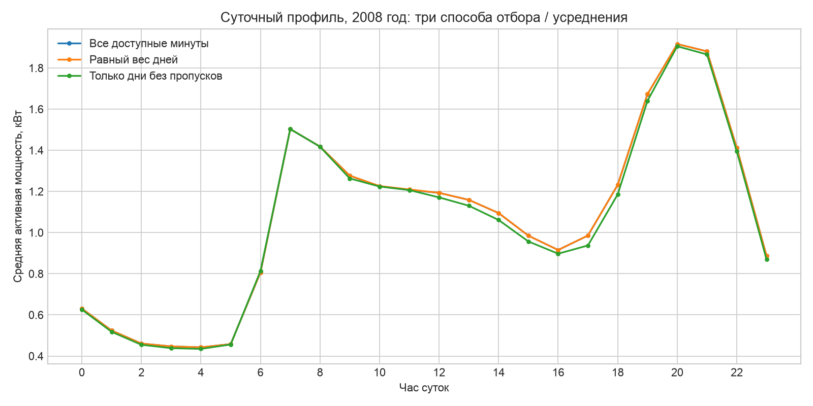
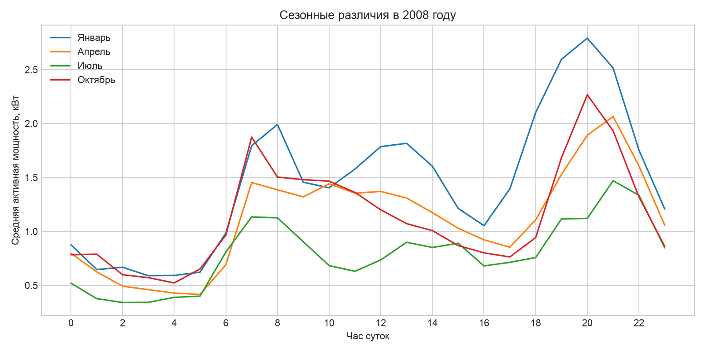
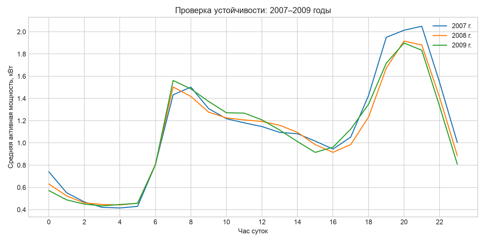
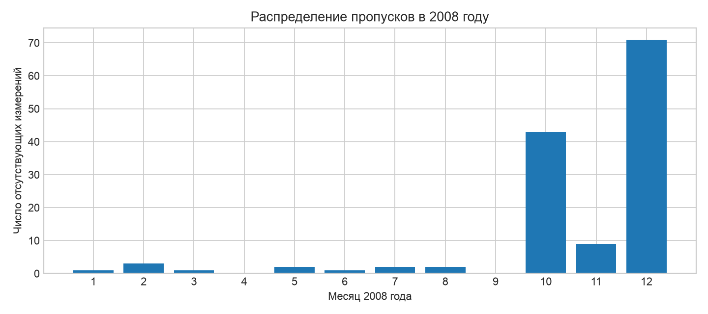
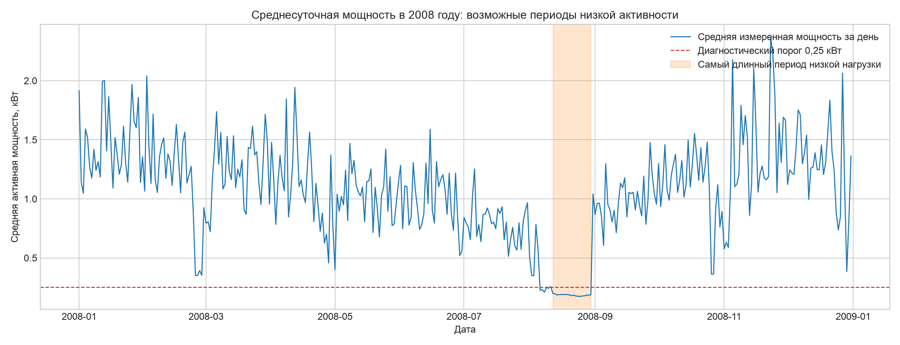
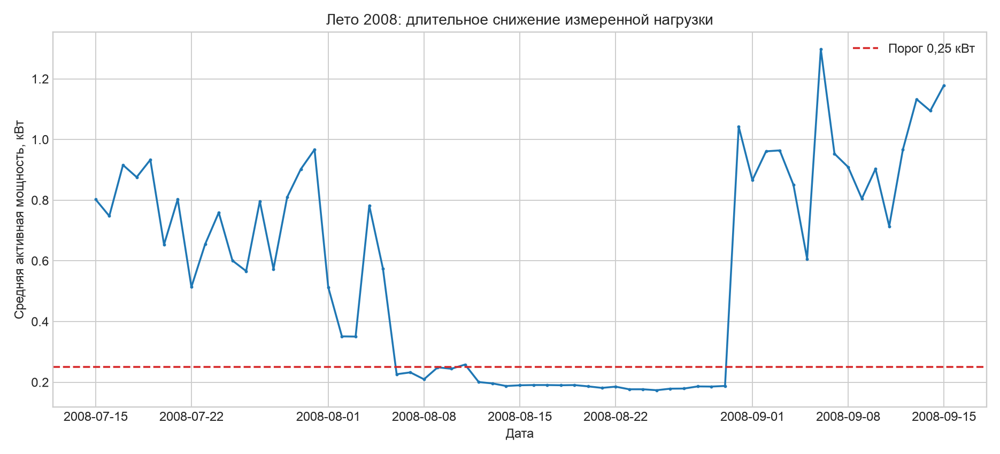

# Суточный профиль электропотребления дома

## 1. Цель работы

Цель исследования — определить, как меняется потребление электричества в течение суток и насколько результат зависит от полноты данных и способа усреднения. Дополнительно рассматриваются дни с необычно низкой нагрузкой: можно ли по ним предположить изменение привычного режима потребления?

В работе используются **только измеренные значения**. Пропущенные данные не заменяются нулями, средними значениями и не восстанавливаются интерполяцией. Исходный архив не изменяется.

## 2. Данные

Используется набор данных *Individual household electric power consumption* — минутные измерения электропотребления одного дома с 16 декабря 2006 года по 26 ноября 2010 года. Исходный архив находится в `data/household_power_consumption.zip`.

Основные поля исходного файла:

| Столбец | Содержание |
| --- | --- |
| `Date`, `Time` | Дата и время измерения |
| `Global_active_power` | Общая активная мощность, кВт |
| `Global_reactive_power` | Реактивная мощность, квар |
| `Voltage` | Напряжение, В |
| `Global_intensity` | Сила тока, А |
| `Sub_metering_1`, `Sub_metering_2`, `Sub_metering_3` | Показания отдельных каналов учёта |

Для основного анализа выбран показатель `Global_active_power`. Он отражает **общее электропотребление**, а не только освещение. Поэтому нельзя по этим данным определить, когда именно включали свет или действительно ли жильцы уезжали.

Файл содержит 2 075 259 строк; пропуски в исходных таблицах обозначены знаком `?`.

## 3. Выбор периода

Основной период — **весь 2008 год**. Один месяц был бы удобен для изучения отдельного сезона, но не позволил бы оценить изменения в течение года. 2008 год содержит все четыре сезона и отличается высокой полнотой измерений. Для проверки устойчивости выводов дополнительно сравниваются 2007 и 2009 годы.

| Год | Ожидаемых минут | Отсутствующих значений мощности | Доля имеющихся значений |
| --- | ---: | ---: | ---: |
| 2007 | 525 600 | 3 931 | 99,25 % |
| **2008** | **527 040** | **135** | **99,97 %** |
| 2009 | 525 600 | 4 280 | 99,19 % |

Эти числа относятся к измерениям мощности и не заменяют проверку временных отметок.

## 4. Подготовка и проверка качества данных

Обработка выполняется только в оперативной памяти: исходный ZIP не перезаписывается.

1. Считываются исходные строки, дата и время объединяются в одну временную отметку.
2. Проверяются неправильно записанные дата и время и повторяющиеся временные отметки. Повторные отметки при наличии исключаются из расчётов.
3. Подсчитываются отсутствующие минутные отметки. **Отсутствующая строка** и **строка с пустой мощностью** считаются разными ситуациями.
4. Из расчёта исключаются строки без `Global_active_power` и значения, которые невозможно интерпретировать как допустимую неотрицательную конечную мощность.
5. Большие значения проверяются статистическим критерием `Q3 + 3 × (Q3 − Q1)`, но не удаляются автоматически: кратковременная высокая мощность может соответствовать реальному включению прибора.

По итогам проверки основного периода:

| Показатель за 2008 год | Результат |
| --- | ---: |
| Всего строк | 527 040 |
| Отсутствующие минутные отметки | 0 |
| Повторные минутные отметки | 0 |
| Пустые значения активной мощности | 135 |
| Невозможные значения мощности среди оставшихся | 0 |
| Измерения, участвующие в анализе | **526 905** |
| Дни с полным набором из 1 440 измерений | **351 из 366** |
| Значения выше диагностического порога 5,172 кВт | 3 726 (оставлены) |

Удаление измерений по одному лишь признаку «большое значение» могло бы искусственно уменьшить вечерние пики. Поэтому статистический порог используется для описания, а не автоматической фильтрации.

## 5. Методы анализа

### 5.1. Средний суточный профиль

Минутные измерения распределяются по часам суток от 0 до 23. Для каждого часа вычисляется средняя измеренная активная мощность (кВт). Сравниваются три варианта:

- **Все доступные минуты:** среднее по всем действительным минутным измерениям соответствующего часа за 2008 год.
- **Равный вес дней:** сначала вычисляется средняя мощность внутри каждого наблюдаемого часа каждого дня, затем эти средние усредняются между днями. У каждого дня одинаковый вес в рамках часа.
- **Только полные дни:** берутся только 351 день, в каждом из которых есть 1 440 действительных минутных измерений.

Во всех трёх вариантах отсутствующие значения **пропускаются**, а не заполняются. Различие между методами связано с весом неполных дней и составом выборки.

### 5.2. Сравнение сезонов и годов

Для января, апреля, июля и октября 2008 года строятся отдельные суточные профили. Также сравниваются почасовые профили 2007, 2008 и 2009 годов. Это помогает понять, насколько профиль конкретного месяца или года отличается от выбранного основного периода.

### 5.3. Дни и периоды с низкой нагрузкой

Для каждого дня 2008 года вычисляются средняя мощность, количество реальных минутных наблюдений и доля покрытия. Дни с покрытием менее 95 % не рассматриваются как надёжные кандидаты на низкое потребление.

Используются два **условных исследовательских критерия**:

- абсолютный: средняя мощность за день меньше **0,25 кВт**;
- относительный: средняя мощность за день меньше **65 %** медианы дневных средних для того же месяца и дня недели.

Первый критерий помогает найти последовательности дней с очень низкой нагрузкой. Второй — выделить дни, которые сильно отличаются от сопоставимых календарных дней. Пороги выбраны для описательного анализа, а не как доказательство отсутствия людей дома.

Для отдельных календарных дат также сравнивается средняя мощность с медианой дней того же месяца и дня недели. Совпадение с праздником само по себе не объясняет расход электричества.

## 6. Результаты

### 6.1. Суточный профиль



По среднему профилю 2008 года максимальная мощность наблюдается около **20:00** (1,916 кВт), минимальная — около **04:00** (0,442 кВт). Таким образом, вечерняя нагрузка значительно выше ночной.

Три способа обработки приводят к близким, но не полностью одинаковым кривым. Наибольшее отличие почасового значения при переходе от всех доступных минут к только полным дням составляет **0,048 кВт**. Это показывает, что для выбранного почти полного года общая форма профиля довольно устойчива к способу учёта пропусков. Такой вывод не обязательно сохранится для набора с большим количеством пропусков.

### 6.2. Сезонные различия



Кривые января, апреля, июля и октября различаются. Следовательно, профиль одного месяца не следует автоматически считать профилем всего года. Для обобщения выбран годовой интервал.

### 6.3. Сравнение годов



Сравнение 2007–2009 годов показывает, что абсолютный уровень потребления меняется от года к году. Поэтому результаты 2008 года описывают конкретный дом и период, а не универсальную норму для всех домов.

### 6.4. Пропуски



В 2008 году пропуски редки (135 на 527 040 минут). Однако даже небольшой процент пропусков не гарантирует, что каждый день полностью наблюдался: полностью заполнен 351 день из 366.

### 6.5. Периоды низкого потребления





Наиболее заметная последовательность низкого потребления — **12–30 августа 2008 года**, 19 дней подряд со средней дневной мощностью менее 0,25 кВт. Средняя мощность за этот период составляет **0,186 кВт**; каждый из этих дней имеет **100 % минутных измерений**. Следовательно, низкие значения не объясняются пропущенными записями.

Возможное объяснение — изменение режима использования электроприборов, в том числе поездка жильцов. Но это **гипотеза**, а не установленный факт: низкое потребление также может быть связано с отключением части приборов или другими обстоятельствами.

Примеры отдельных дат (сравнение с медианой того же месяца и дня недели):

| Дата | Средняя мощность, кВт | Отклонение от ориентира |
| --- | ---: | ---: |
| 01.01.2008 | 1,916 | примерно на 3 % выше |
| 01.05.2008 | 0,400 | примерно на 49 % ниже |
| 25.12.2008 | 0,737 | примерно на 33 % ниже |
| 29.12.2008 | 0,386 | примерно на 69 % ниже |

Эти примеры показывают, что в календарные даты могут наблюдаться как высокие, так и низкие значения. Данные не позволяют утверждать, что причиной конкретного снижения был праздник или отпуск.

## 7. Выводы

1. Среднесуточный профиль выбранного дома неоднороден: основной максимум наблюдается вечером, минимум — ранним утром.
2. Для почти полностью наблюдаемого 2008 года пропуски и выбор способа усреднения слабо меняют общую форму кривой. Это подтверждается сравнением трёх методов без заполнения данных.
3. Суточный профиль зависит и от сезона, и от выбранного года. Поэтому использование только одного месяца может дать неполную картину.
4. В данных обнаружены отдельные дни и продолжительные периоды необычно низкой нагрузки. Особенно выделяется период 12–30 августа 2008 года, который не является следствием пропусков измерений.
5. По показаниям общей мощности можно делать предположения об изменении бытовой активности, но нельзя достоверно определить, отсутствовали ли жильцы, куда они уезжали или сколько электричества расходовалось именно на свет.

**Итог:** наиболее надёжный вывод получается при сочетании проверки качества данных, сравнения нескольких способов усреднения и анализа достаточно длительного периода. Исходные измерения при этом сохраняются без изменений.

## 8. Структура проекта

```text
household-energy-profile/
├── data/
│   └── household_power_consumption.zip
├── notebooks/
│   └── 01_energy_profile.ipynb
├── src/
│   ├── __init__.py
│   └── analysis.py
├── figures/                 # графики и итоговые таблицы
├── requirements.txt
└── README.md
```

`data/` — исходные данные. `src/analysis.py` — расчёты и сохранение результатов. `notebooks/01_energy_profile.ipynb` — последовательное выполнение исследования с пояснениями и графиками. `figures/` — готовые PNG и CSV, которые можно открыть без запуска кода.

## 9. Установка и запуск

Нужны **Python 3.13**, **VS Code** (если работа выполняется в редакторе) и доступ к интернету при первой установке библиотек. Рекомендуется Python 3.13, поскольку проект проверялся с этой версией; более новые версии не всегда совместимы со всеми зависимостями.

Скачайте архив проекта, распакуйте его и откройте папку `household-energy-profile`. Команды ниже нужно выполнять **из корня этой папки**, где находится `requirements.txt`.

### macOS

Установите Python 3.13 с [python.org](https://www.python.org/downloads/) (для Apple Silicon подходит установщик macOS universal2). Откройте терминал в папке проекта и выполните команды **по одной**:

```bash
python3.13 -m venv .venv
.venv/bin/python -m pip install -r requirements.txt
.venv/bin/python -m src.analysis
```

Готовые графики появятся в `figures/`.

### Windows

Установите Python 3.13 с [python.org](https://www.python.org/downloads/). В PowerShell, открытом в папке проекта, выполните:

```powershell
py -3.13 -m venv .venv
.\.venv\Scripts\python.exe -m pip install -r requirements.txt
.\.venv\Scripts\python.exe -m src.analysis
```

Для этих команд активировать окружение через `Activate.ps1` не нужно. Если команда `py -3.13` не работает, убедитесь, что установлен Python 3.13 и Python Launcher.

### Linux

Установите Python 3.13 и поддержку `venv` через пакетный менеджер дистрибутива. На некоторых системах Python 3.13 нужно устанавливать отдельно. В терминале папки проекта выполните:

```bash
python3.13 -m venv .venv
.venv/bin/python -m pip install -r requirements.txt
.venv/bin/python -m src.analysis
```

Если создание окружения не работает с сообщением об отсутствии `ensurepip` или `venv`, установите системный пакет поддержки виртуальных окружений для используемой версии Python.

### Запуск в Jupyter Notebook (для всех систем)

1. Откройте папку проекта в VS Code.
2. Установите расширения **Python** и **Jupyter** от Microsoft.
3. Откройте `notebooks/01_energy_profile.ipynb`.
4. В правом верхнем углу нажмите **Select Kernel** и выберите Python из окружения `.venv` (версия 3.13). При необходимости укажите путь `.venv/bin/python` (macOS/Linux) или `.venv\Scripts\python.exe` (Windows).
5. Нажмите **Run All**. Результаты и графики появятся прямо под ячейками ноутбука.

Запуск ноутбука не требует отдельно поднимать сервер Jupyter: необходимые библиотеки, включая `ipykernel`, перечислены в `requirements.txt`.

**Проверка результата:** после запуска должны создаться изображения `daily_profiles.png`, `seasonal_profiles.png`, `year_comparison.png`, `daily_consumption_timeline.png` и другие файлы в `figures/`. Если изображения уже есть, они будут обновлены после повторного анализа.

### Возможные ошибки

- **`No module named ...`** — зависимости установлены не в то окружение или выбран не тот Kernel. Установите `requirements.txt` через Python из `.venv` и выберите это окружение в ноутбуке.
- **`No matching distribution found` / ошибки установки pandas** — убедитесь, что виртуальное окружение создано именно с Python 3.13, а не с другой версией.
- **`FileNotFoundError`** — команды выполняются не из корня проекта или отсутствует архив `data/household_power_consumption.zip`.
- **`Select Kernel` не показывает `.venv`** — перезапустите VS Code, проверьте установку расширений Python и Jupyter, затем укажите путь к интерпретатору вручную.

## 10. Ограничения исследования

Исследуется один дом, без сведений о составе семьи, фактических отъездах и использовании конкретных приборов. Часовой график представляет **среднюю мощность (кВт)**, а не суммарное количество энергии (кВт·ч). Сравнение отдельных дат является описательным, а выбранные пороги низкой нагрузки условны. По этой причине результаты применимы прежде всего к данному набору данных и не являются доказательством причин поведения жильцов.